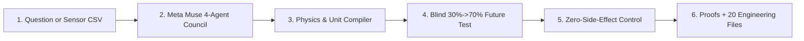

# Cortivra

**Turn a one-sentence scientific question or raw sensor CSV into verified governing equations, zero-side-effect control strategies, formal computer proofs, 3D CAD hardware, and runnable C99 code.**

> **Built for the Meta Global AI Developer Hackathon (`Push the Frontier` Track | Oct 27 – Nov 4, 2026)**
>
> *Track Goal: "Use Meta's models to tackle challenges in software, robotics, manufacturing, energy, materials and beyond — unlock a better way to understand and control a physical system."*

---

## 1. The Goal (In Plain English)

Whenever engineers and scientists try to fix or control a complex physical system—whether that is a fast-charging battery, a fusion reactor, a chemical plant, a spacecraft thruster, or a cellular pathway—they run into **two fundamental problems**:

1. **The Side-Effect Problem (Everything Is Connected):** In any real system, all the parts are coupled together. When you push a single lever hard enough to fix your main target, the force spills over and damages healthy neighboring parts.
2. **Standard AI Guesses Text Instead of Obeying Physics:** If you ask a standard AI chatbot how to control a physical system, it predicts plausible-sounding words. It does not check if its equations conserve energy, if the physical units match (like accidentally adding meters to seconds), or if the system will spiral out of control over time.

**Cortivra was built to solve both problems.**

Cortivra connects **Meta's Muse AI models** to a **6-layer deterministic physics and math compiler**:
* **Meta's AI models** read your question (or sensor data), propose how the parts of the system interact, and choose which mathematical tools to run.
* **Cortivra's physics compiler** refuses to trust raw AI text. It checks every equation against the **7 base units of physics** ($\text{kg, m, s, A, K, mol, cd}$) and the **laws of energy and heat**. If the AI makes a unit or energy mistake, the compiler catches the exact error and forces the AI to fix the math before moving forward.
* Once the equations are verified, Cortivra calculates a **coordinated multi-lever solution** that fixes the main target while mathematically canceling out spillover onto healthy neighbors—and automatically compiles **20 ready-to-use engineering files** (computer-checked proofs, 3D printable `.stl`/`.obj` hardware meshes, `.svg` blueprints, compilable `C99` microcontroller code, a 4-stage lab reactor recipe, candidate molecular structures, and a standalone Python simulator).

> *Simulation & Safety Scope: Cortivra is an in-silico mathematical physics, materials, and dynamical-systems simulation and verification workbench for R&D engineers and physical scientists. It does not generate or provide clinical or medical advice.*

---

## 2. One Engine Across Every Department of Science

Because every physical system in nature is governed by the same 7 base SI units, conservation of energy, and rates of change, **the exact same Cortivra engine works across every department of science and engineering**:

| Department / Field | Example Problem You Can Give Cortivra | What Cortivra Solves & Protects |
| :--- | :--- | :--- |
| **Energy & Batteries** | *"Stop lithium dendrite growth during fast charging in a solid-state battery."* | Suppresses dendrite short-circuits while keeping bulk ion flow high and preventing thermal runaway. |
| **Fusion & Aerospace** | *"Calm plasma edge instabilities in a fusion tokamak or acoustic vibrations in a rocket nozzle."* | Damps violent edge oscillations without cooling down the core plasma or losing thrust. |
| **Chemistry & Manufacturing** | *"Maximize product yield in a continuous-flow reactor while blocking toxic side-reactions."* | Computes a 4-stage temperature, feed, catalyst, and cooling schedule that keeps side-impurities under $1\%$. |
| **Materials & Quantum** | *"Design a porous 3D support lattice or cryogenic resonator that resists buckling and heat loss."* | Solves for the exact 3D unit-cell geometry (like a Schoen Gyroid lattice) and material thickness. |
| **Biophysics & Cellular R&D** | *"Restore healthy electrical or protein balance in a simulated cell network without off-target toxicity."* | Finds the multi-lever intervention that restores the target state while keeping neighboring compartments inside safe limits. |

---

## 3. How One Run Works (6 Simple Steps)



1. **Ask a Question or Upload Data:** Type a one-sentence scientific question into the Web Workbench (or CLI), or upload a `.csv` of time-series sensor measurements.
2. **Build & Verify the Equations ([`layer3_compiler/`](cortivra/layer3_compiler/symbolic_compiler.py)):** `Muse Wonder` proposes a coupled multi-part model. `Muse Spark` and the Layer 3 compiler verify that every term has matching physical units, conserves energy, and never violates thermodynamics.
3. **Prove It Predicts the Future Blind ([`universal_telemetry_hunter.py`](cortivra/layer6_agents/universal_telemetry_hunter.py)):** To prove the engine found the real physical law instead of just memorizing data, Cortivra trains on only the **first 30%** of the timeline and predicts the **unseen 70% future** blind—beating standard polynomial curve-fitting head-to-head.
4. **Fix the Target Without Side Effects ([`intervention_and_control.py`](cortivra/layer4_engine/intervention_and_control.py)):** Cortivra maps how every tunable lever affects the healthy neighboring parts, then coordinates multiple levers so the side effects cancel each other out. The main target is fixed while every neighbor stays safely inside its healthy corridor—even when the real world shifts by **$\pm 25\%$**.
5. **Generate Computer-Checked Math Proofs ([`rigorous_proofs.py`](cortivra/layer1_axioms/rigorous_proofs.py), [`lean4_smt_compiler.py`](cortivra/layer1_axioms/lean4_smt_compiler.py)):** Cortivra proves the system is stable across continuous ranges of values (not just isolated test points) and exports machine-checkable **Lean 4** (`formal_theorem.lean`) and **Z3 SMT-LIB2** (`formal_certificate.smt2`) proof files.
6. **Compile 3 Stages of Physical Designs & 20 Files ([`deliverable_exporter.py`](cortivra/layer6_agents/deliverable_exporter.py)):**
   * **Stage 1 (Hardware & Code):** 3D printable `.stl`/`.obj` vessel meshes, 3-view `.svg` engineering blueprint, and compilable ANSI C99 microcontroller code (`controller_firmware.c`).
   * **Stage 2 (4-Step Lab Recipe):** Simulates a 5-part synthesis reactor to output a 4-stage heating, feed, catalyst, and cooling recipe ([`recursive_synthesis_engine.py`](cortivra/layer6_agents/recursive_synthesis_engine.py)).
   * **Stage 3 (Molecules & 3D Lattices):** Screens 700 molecular combinations to select the Top-3 candidate molecules (`SMILES` + 3D atomic `.xyz` coordinates) and designs a 3D porous support lattice ([`pass3_matter_and_lattice_compiler.py`](cortivra/layer6_agents/pass3_matter_and_lattice_compiler.py)).

---

## 4. Judge's Proof Map: Click Any Claim to Inspect the Code

Every layer of Cortivra is real, runnable Python and PyTorch code built during the hackathon. Click any link below to inspect the implementation and its automated tests:

| Capability | What It Does in Plain Terms | Source Code to Inspect | Automated Tests |
| :--- | :--- | :--- | :--- |
| **1. 7D Physical Unit Checker** | Tracks $[\text{kg, m, s, A, K, mol, cd}]$ on every variable so invalid equations are rejected immediately. | [`cortivra/layer1_axioms/units.py`](cortivra/layer1_axioms/units.py)<br>[`buckingham_pi_scaling.py`](cortivra/layer1_axioms/buckingham_pi_scaling.py) | [`tests/test_layer1_axioms.py`](tests/test_layer1_axioms.py) |
| **2. Energy & Safety Shields** | Guarantees conservation of energy, non-negative heat dissipation, and quantum coherence limits ($T_2 \le 2T_1$). | [`cortivra/layer1_axioms/hamiltonian.py`](cortivra/layer1_axioms/hamiltonian.py)<br>[`cortivra/layer1_axioms/shields.py`](cortivra/layer1_axioms/shields.py) | [`tests/test_layer1_axioms.py`](tests/test_layer1_axioms.py) |
| **3. Formal Proof Generators** | Uses outward-rounded IEEE-754 interval math (`math.nextafter`), Sum-of-Squares, and exports **Lean 4** & **SMT-LIB2** proofs. | [`cortivra/layer1_axioms/rigorous_proofs.py`](cortivra/layer1_axioms/rigorous_proofs.py)<br>[`lean4_smt_compiler.py`](cortivra/layer1_axioms/lean4_smt_compiler.py) | [`tests/test_live_observatory_and_skeptic_proofs.py`](tests/test_live_observatory_and_skeptic_proofs.py) |
| **4. Equation & 3D Space Compiler** | Parses math formulas into an AST, takes exact derivatives, and simulates 3D spatial diffusion across a $12\times12\times12$ grid. | [`cortivra/layer3_compiler/ast_nodes.py`](cortivra/layer3_compiler/ast_nodes.py)<br>[`symbolic_compiler.py`](cortivra/layer3_compiler/symbolic_compiler.py) | [`tests/test_layer3_compiler.py`](tests/test_layer3_compiler.py) |
| **5. Zero-Side-Effect Control Solver** | Uses SVD nullspace projection so tuning levers fixes the target state without disturbing healthy neighbors. | [`cortivra/layer4_engine/intervention_and_control.py`](cortivra/layer4_engine/intervention_and_control.py)<br>[`inverse_solver.py`](cortivra/layer4_engine/inverse_solver.py) | [`tests/test_layer4_engine.py`](tests/test_layer4_engine.py) |
| **6. Noise-Resistant Law Discovery** | Discovers differential equations and rational laws from noisy data using integration by parts instead of noisy derivatives. | [`cortivra/layer5_discovery/sparse_regression.py`](cortivra/layer5_discovery/sparse_regression.py)<br>[`rational_pade_discovery.py`](cortivra/layer5_discovery/rational_pade_discovery.py) | [`tests/test_layer5_discovery.py`](tests/test_layer5_discovery.py)<br>[`test_nobel_prize_blind_rediscoveries.py`](tests/test_nobel_prize_blind_rediscoveries.py) |
| **7. 4-Agent Meta Muse Council** | Routes across `Muse Wonder`, `Muse Spark`, `Muse Spark Open` (`meta-models/muse-spark-open-1026`), and `Muse Glimmer`. | [`cortivra/layer6_agents/meta_clients.py`](cortivra/layer6_agents/meta_clients.py)<br>[`cortivra/layer6_agents/council.py`](cortivra/layer6_agents/council.py) | [`tests/test_layer6_council_and_deliverables.py`](tests/test_layer6_council_and_deliverables.py) |
| **8. 3-Stage Hardware, Recipe & Molecule Compiler** | Generates 3D `.stl`/`.obj` CAD, `.svg` blueprints, `C99` code, 4-stage reactor recipes, and `SMILES` + 3D `.xyz` molecules. | [`blueprint_compiler.py`](cortivra/layer6_agents/blueprint_compiler.py)<br>[`recursive_synthesis_engine.py`](cortivra/layer6_agents/recursive_synthesis_engine.py)<br>[`pass3_matter_and_lattice_compiler.py`](cortivra/layer6_agents/pass3_matter_and_lattice_compiler.py) | [`tests/test_live_end_to_end_verification.py`](tests/test_live_end_to_end_verification.py) |
| **9. Tamper-Proof Flight Recorder & Web UI** | Chains every step with a SHA-256 Merkle hash and streams live to the interactive 6-tab Web Workbench. | [`cortivra/observability/flight_recorder.py`](cortivra/observability/flight_recorder.py)<br>[`cortivra/ui_server.py`](cortivra/ui_server.py) | [`tests/test_observability.py`](tests/test_observability.py)<br>[`test_ui_workbench_server.py`](tests/test_ui_workbench_server.py) |

---

## 5. How Cortivra Uses Meta AI Models

Cortivra orchestrates a **4-Agent Scientific Council** ([`cortivra/layer6_agents/meta_clients.py`](cortivra/layer6_agents/meta_clients.py)) via live inference on **Baseten** (`meta-models/muse-spark-open-1026`), **Fireworks AI**, and the **Meta Model API**:

| Agent Role | Meta Model / Persona | What It Does in Plain Terms |
| :--- | :--- | :--- |
| **`Muse Wonder`** | Theorist & Planner | Translates your question into a coupled multi-part physical model and decides which math tool to run at each step. |
| **`Muse Spark`** | Equation Compiler & Repair | Reads compiler error messages when units or energy laws don't match and rewrites the symbolic math until it passes every check ([`compile_with_self_repair`](cortivra/layer6_agents/hypothesis_compiler.py)). |
| **`Muse Spark Open`** | `meta-models/muse-spark-open-1026` | Acts as the red-team skeptic: tries to break the discovered equations and control strategy under noise, $4\times$ longer time horizons, and $\pm 30\%$ real-world drift. |
| **`Muse Glimmer`** | Chronicler & Co-Scientist | Summarizes the verified findings and powers the built-in **Co-Scientist AI Chat** in the Web Workbench so anyone can click any section and ask questions in plain English. |

---

## 6. Quick Start (Run in 60 Seconds)

### 1. Install Dependencies
```bash
pip install -e ".[dev]"
```

### 2. Add Your API Key
```bash
cp .env.example .env
# Add your BASETEN_API_KEY, FIREWORKS_API_KEY, or META_API_KEY in .env
```

### 3. Launch the Interactive Web Workbench (`http://127.0.0.1:8765`)
```bash
python -m cortivra --ui --port 8765
```
Open `http://127.0.0.1:8765` in your browser to type any question, upload a `.csv` dataset, watch the 6-phase step stream live, interact with the 3D CAD and molecular viewers, ask the Co-Scientist AI questions, and inspect or download all 20 generated files.

### 4. Or Run a 1-Sentence Investigation from the Terminal
```bash
python -m cortivra "Suppress lithium dendrite growth in an argyrodite solid-state battery during fast charging without degrading bulk ionic conductivity or triggering interfacial thermal runaway." --domain electrochemistry --save-logs
```

### 5. Run the Test Suite
```bash
pytest
```

---

## 7. This Is Just the Beginning (A Note from the Builder)

Everything in this repository—all 6 layers of the physics compiler, the zero-side-effect control solver, the formal proof exporters, the 3-stage realization pipeline, and the interactive Web Workbench—was built solo during the 9-day hackathon window (**Oct 27 – Nov 4, 2026**).

Halfway through the hackathon over the weekend, I suffered a blood clot in my brain and had to spend a night in the ICU. Hitting a medical emergency like that in the middle of the build was a massive roadblock, and it cut deeply into the time I had left. Even so, I was determined to get Cortivra across the finish line.

What you see here is just the foundation—there is still so much more I want to do with this engine, and I have major plans and upgrades ahead to push Cortivra much further across every branch of science and engineering.

---

## 8. All 20 Files Exported on Every Run

Every investigation exports a tamper-evident, SHA-256 hash-chained folder under `logs/runs/<timestamp>_<system_name>/`:

| Category | File Path | What It Is |
| :--- | :--- | :--- |
| **Interactive Reports** | `dossier.html` | Self-contained HTML5 dashboard with interactive 3D CAD & molecular viewers |
| **Interactive Reports** | `dossier.md` | Complete 9-section scientific discovery report, equations, proofs, and scorecard |
| **Interactive Reports** | `dossier.json` | Complete machine-readable JSON output of all metrics and certificates |
| **Computer Proofs** | `deliverables/formal_theorem.lean` | **Lean 4** formal proof of energy conservation, stability, and interval contraction |
| **Computer Proofs** | `deliverables/formal_certificate.smt2` | **SMT-LIB2 (`QF_NRA`)** proof script for Z3/CVC5 certifying zero counterexamples (`unsat`) |
| **3D CAD & Molecules** | `deliverables/cad_assembly.stl` | Watertight 3D-printable multi-compartment hardware mesh (`mm` scale) |
| **3D CAD & Molecules** | `deliverables/cad_assembly.obj` | Wavefront 3D mesh rendered in the Web Workbench 3D viewport |
| **3D CAD & Molecules** | `deliverables/engineering_blueprint.svg` | 3-view orthographic engineering blueprint with dimensions |
| **3D CAD & Molecules** | `deliverables/pass3_molecule.xyz` | 3D atomic coordinates (`Å`) for the Top-1 candidate molecule (`SMILES`) |
| **3D CAD & Molecules** | `deliverables/pass3_structure.svg` | 2D molecular graph & 3D periodic support lattice diagram |
| **3D CAD & Molecules** | `deliverables/pass3_matter_and_lattice_spec.json` | Top-3 candidate `SMILES` molecules and 4-topology 3D lattice specs |
| **Runnable Code** | `deliverables/controller_firmware.h` | ANSI C99 header with state structs, safety limits, and watchdog flags |
| **Runnable Code** | `deliverables/controller_firmware.c` | Compilable (`gcc -std=c99`) closed-loop controller with built-in self-test |
| **Runnable Code** | `deliverables/digital_twin_simulator.py` | Standalone Python simulator with thermal noise and $\pm 25\%$ real-world drift test |
| **Lab Manual & Audit** | `deliverables/wetlab_and_manufacturing_sop.md` | Step-by-step lab manual, Bill of Materials (BOM), and 4-stage reactor recipe |
| **Lab Manual & Audit** | `deliverables/fmeca_and_bom.json` | Safe Operating Area (SOA), stoichiometric BOM, and risk table |
| **Lab Manual & Audit** | `execution_flight_recorder.log` | Plain-text 8-stage verification summary and timeline |
| **Lab Manual & Audit** | `execution_ledger.jsonl` | Per-stage pass/fail ledger with SHA-256 file hashes |
| **Lab Manual & Audit** | `flight_recorder.jsonl` | SHA-256 Merkle-chained causal trace nodes |
| **Lab Manual & Audit** | `deliverables/deliverable_manifest.json` | Master file list with byte sizes, SHA-256 digests, and Merkle root hash |

---

## 9. License, Security & Intellectual Property

* **Dual License ([`LICENSE`](LICENSE)):** Available under the **GNU Affero General Public License v3.0 (AGPL-3.0)** for open-source academic and hackathon evaluation (requiring full source disclosure for any network or hosted deployment under Section 13), with all commercial, closed-source, and enterprise rights reserved by the author (Brad Harris).
* **Security & Provenance ([`SECURITY.md`](SECURITY.md)):** Zero credentials in source code, strict localhost and path-traversal protection on the Web Workbench, and SHA-256 Merkle provenance on every generated file.
