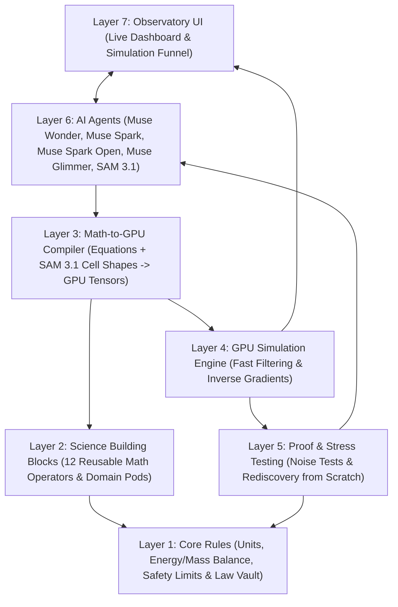

# Cortivra

**Cortivra** is a physics and biology sandbox where AI models turn scientific questions into math, run millions of parallel simulations on the GPU, filter out what breaks the laws of nature, and verify what works.

Instead of hardcoding outcomes for one narrow problem, Cortivra uses a shared set of basic physical rules and math building blocks. This lets a single engine connect chemistry, cell ion channels, 3D cell shape, and brain network activity—and test ideas from scratch.

---

## How It Works (The 7 Layers)



| Layer | Folder | What It Does |
| :--- | :--- | :--- |
| **Layer 1** | `cortivra/layer1_axioms/` | Checks units, tracks energy, mass, and charge balance, enforces safety limits, and saves proven rules in the Vault. |
| **Layer 2** | `cortivra/layer2_fabric/` | 12 reusable math building blocks that snap together to model chemistry, ion channels, cells, brain circuits, or mechanics. |
| **Layer 3** | `cortivra/layer3_compiler/` | Takes equations and real cell shapes from **SAM 3.1** and turns them into fast GPU tensors. |
| **Layer 4** | `cortivra/layer4_engine/` | Tests millions of possibilities in parallel on the GPU, filters out bad states, and uses gradients to find exact solutions. |
| **Layer 5** | `cortivra/layer5_proof/` | Shakes surviving solutions with noise and stress tests to make sure they are real—including blind tests to rediscover known science from scratch. |
| **Layer 6** | `cortivra/layer6_agents/` | Uses **Muse Wonder**, **Muse Spark**, **Muse Spark Open**, **Muse Glimmer**, and **SAM 3.1** to turn questions into equations and steer the engine. |
| **Layer 7** | `cortivra/layer7_observatory/` | Live dashboard showing simulations, multi-scale connections, and results in real time. |

---

## Folder Structure

```text
cortivra/
├── cortivra/
│   ├── layer1_axioms/        # Units, conservation laws, safety limits & Law Vault
│   ├── layer2_fabric/        # 12 math building blocks & science modules
│   ├── layer3_compiler/      # Equation-to-GPU compiler & SAM 3.1 geometry bridge
│   ├── layer4_engine/        # Parallel GPU filtering & inverse solver
│   ├── layer5_proof/         # Stress testing & blind rediscovery checks
│   ├── layer6_agents/        # Meta AI agents (Muse & SAM 3.1)
│   └── layer7_observatory/   # Live telemetry server
├── observatory_ui/           # Web dashboard frontend
├── proofs/                   # Benchmarks testing rediscovery from scratch
├── tests/                    # Unit tests for each layer
├── docs/
│   └── CORTIVRA_BLUEPRINT.md # Project notes and design blueprint
├── .env.example              # Template for API keys
└── pyproject.toml            # Dependencies and test setup
```

---

## Quick Start

1. **Install dependencies:**
   ```bash
   pip install -e ".[dev]"
   ```

2. **Set up API keys:**
   ```bash
   cp .env.example .env
   ```

3. **Run tests:**
   ```bash
   pytest
   ```
