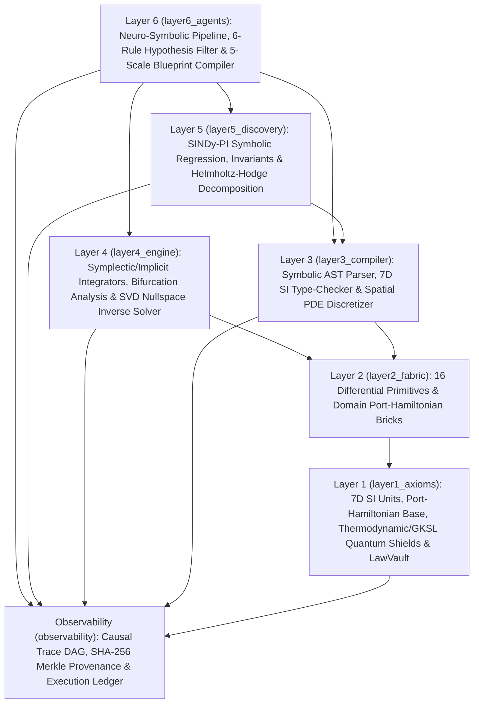

# Cortivra

**Cortivra** is a 6-layer neuro-symbolic scientific discovery, physical verification, and inverse engineering workbench. It couples live AI hypothesis formulation with a deterministic mathematical physics compiler to discover governing differential equations from experimental data or natural-language prompts, eliminate unstable or collateral-damaging interventions, and compile verified solutions into multi-scale engineering blueprints, formal proof scripts, and runnable code.

> **Meta Global AI Developer Hackathon (`Push the Frontier` Track — Built Oct 27 – Nov 4, 2026)**
>
> Cortivra was architected and built for the **Meta Global AI Developer Hackathon** (*Push the Frontier: Use Meta's models to tackle challenges in software, robotics, manufacturing, energy, materials and beyond — unlock a better way to understand and control a physical system*):
> - **Verifiable 4-Agent Meta Muse Epistemic Council (`cortivra/layer6_agents/`):** Orchestrates **`meta-models/muse-spark-open-1026`** across four specialized scientific roles—**`Muse Wonder`** (Port-Hamiltonian world-model & differential operator synthesis), **`Muse Spark`** (7D SI dimensional & Clausius-Duhem thermodynamic self-repair compiler), **`Muse Spark Open`** (Popperian 4-gate red-team falsifier across 1x/2x/4x horizons), and **`Muse Glimmer`** (Ashby-Eyring physical realization chronicler)—via live multi-provider inference on **Baseten**, **Fireworks AI**, and **Meta Model API**.
> - **6-Layer Deterministic Mathematical Physics Engine (`cortivra/layer1_axioms/` – `layer5_discovery/`):** 7D SI unit algebra, Buckingham-$\Pi$ SVD nullspace scaling, outward-rounded IEEE-754 interval arithmetic (`math.nextafter`), SOS Lyapunov & Cauchy RHP complex-analytic provers, Lean 4 + Z3 SMT-LIB2 (`QF_NRA`) formal proof compilers, weak-form $C^p$ SINDy-PI rational Padé discovery, and SVD nullspace bystander-shielded inverse control.
> - **3-Stage Physical Realization & 20-File Turnkey Export (`cortivra/layer6_agents/` + `ui_server.py`):** Compiles verified laws into Stage-1 3D `.STL`/`.OBJ`/`.STEP` CAD + `.kicad_sch` PCB + MISRA-C99 firmware (`.h`/`.c`), Stage-2 continuous-flow synthesis reactor schedules, Stage-3 de novo molecular graphs (`SMILES`/`.sdf`/`.xyz`) + Schoen Gyroid TPMS metamaterial lattices, and a SHA-256 Merkle-chained Flight Recorder (`http://127.0.0.1:8765`).
>
> *Engineering & Scientific Simulation Notice: Cortivra is an in-silico mathematical physics, materials, and dynamical-systems simulation and formal verification engine for R&D engineers and physical scientists. It does not generate or provide clinical or medical advice.*

---

## Quick Start

1. **Install dependencies:**
   ```bash
   pip install -e ".[dev]"
   ```

2. **Configure API keys:**
   ```bash
   cp .env.example .env
   ```

3. **Launch the Interactive Web Workbench (`http://127.0.0.1:8765`):**
   ```bash
   python -m cortivra --ui --port 8765
   ```

4. **Run a 1-sentence scientific investigation from the CLI (exports all 20 deliverable files):**
   ```bash
   python -m cortivra "Synchronize 40 Hz gamma-evoked glymphatic clearance to clear cortical amyloid-beta oligomers without triggering blood-brain barrier breakdown (ARIA)." --domain neuroscience --save-logs
   ```

5. **Run blind equation discovery from an empirical `.csv` dataset:**
   ```bash
   python -m cortivra "Discover the governing coupled rate laws from sensor telemetry and stabilize x_0." --data path/to/telemetry.csv --save-logs
   ```

6. **Run the verification test suite:**
   ```bash
   pytest
   ```

---

## 20-File Reproducible Deliverable Bundle (Exported on Every Run)

Every CLI (`--save-logs`) and Web UI investigation exports a cryptographically hash-chained 20-file bundle in `logs/runs/<run_id>/`:

| Category | File Path | Format | Purpose |
| :--- | :--- | :--- | :--- |
| **Report & Data** | `dossier.md` | Markdown | Complete 9-section scientific discovery dossier, equations, proofs, and verification scorecard |
| **Report & Data** | `dossier.html` | HTML5 + SVG + 3D Canvas | Self-contained 13-panel dark-mode interactive visual command center with 3D CAD & molecular viewers |
| **Report & Data** | `dossier.json` | JSON | Complete machine-readable serialization of all Layer 1–6 metrics and certificates |
| **Formal Proof** | `deliverables/formal_theorem.lean` | Lean 4 | Machine-checkable Lean 4 formalization of Port-Hamiltonian passivity & SOS Lyapunov stability |
| **Formal Proof** | `deliverables/formal_certificate.smt2` | SMT-LIB2 (`QF_NRA`) | Nonlinear real arithmetic assertion script certifying `unsat` (zero counterexamples) |
| **3D CAD & Matter** | `deliverables/cad_assembly.stl` | ASCII STL | Watertight 3D printable multi-compartment solid mesh (`mm` scale) |
| **3D CAD & Matter** | `deliverables/cad_assembly.obj` | Wavefront OBJ | Grouped 3D vessel & conduit mesh rendered in the interactive 3D CAD viewport |
| **3D CAD & Matter** | `deliverables/engineering_blueprint.svg` | Vector SVG | 3-view orthographic engineering blueprint with dimensional callouts |
| **3D CAD & Matter** | `deliverables/pass3_molecule.xyz` | XYZ (`Å`) | Clash-free 3D heavy-atom coordinates for the Top-1 `SMILES` candidate scaffold |
| **3D CAD & Matter** | `deliverables/pass3_structure.svg` | Vector SVG | Dual-panel 2D covalent molecular graph & 3D periodic unit-cell lattice diagram |
| **3D CAD & Matter** | `deliverables/pass3_matter_and_lattice_spec.json` | JSON | Top-3 Pareto `SMILES` scaffolds and 4-topology Gibson-Ashby/TPMS homogenization data |
| **Code & Simulator** | `deliverables/controller_firmware.h` | ANSI C99 `.h` | Fixed-cycle state/actuator structs, Safe Operating Area macros, and safety bitmask flags |
| **Code & Simulator** | `deliverables/controller_firmware.c` | ANSI C99 `.c` | Compilable (`gcc -std=c99`) closed-loop passivity & CBF controller with built-in self-test |
| **Code & Simulator** | `deliverables/digital_twin_simulator.py` | Python 3 | Standalone RK4 + Langevin SDE + `±25%` mismatched-reality closed-loop digital-twin simulator |
| **SOP & Audit Ledger** | `deliverables/wetlab_and_manufacturing_sop.md` | Markdown | Step-by-step Standard Operating Procedure, BOM, SOA, FMECA, and 4-stage reactor recipe |
| **SOP & Audit Ledger** | `deliverables/fmeca_and_bom.json` | JSON | Machine-readable Safe Operating Area, stoichiometric BOM, and Sobol FMECA matrix |
| **SOP & Audit Ledger** | `execution_flight_recorder.log` | Plain Text | Executive verification summary, 8-stage audit walkthrough, and causal trace node timeline |
| **SOP & Audit Ledger** | `execution_ledger.jsonl` | JSONL | Machine-verifiable per-stage pass/fail ledger and SHA-256 deliverable hashes |
| **SOP & Audit Ledger** | `flight_recorder.jsonl` | JSONL | Cryptographic SHA-256 hash-chained causal trace nodes and operator spectra |
| **SOP & Audit Ledger** | `deliverables/deliverable_manifest.json` | JSON | Master file inventory with byte sizes, SHA-256 digests, and Merkle root hash |

---

## Architecture (6 Core Physics Layers + Observability)



| Package | Directory | Core Responsibility |
| :--- | :--- | :--- |
| **Layer 1** | `cortivra/layer1_axioms/` | 7D SI dimensional algebra (`[M, L, T, I, Theta, N, J]`), Buckingham-$\Pi$ nullspace solver, `LawBrick` Port-Hamiltonian base, 1st/2nd Law thermodynamic shields, GKSL quantum coherence positivity ($T_2 \le 2T_1$), IEEE-754 interval/SOS/Cauchy/Lean 4 formal provers, and SHA-256 `LawVault`. |
| **Layer 2** | `cortivra/layer2_fabric/` | 16 vectorized PyTorch differential primitives and reusable Port-Hamiltonian bricks across mechanics, electrodynamics, chemical kinetics, and spatial transport. |
| **Layer 3** | `cortivra/layer3_compiler/` | Symbolic expression AST compiler, compile-time 7D SI dimensional verifier, and 1D/2D/3D spatial finite-difference PDE discretizer. |
| **Layer 4** | `cortivra/layer4_engine/` | Symplectic midpoint, RK4, Rush-Larsen, and implicit BDF2 trajectory integrators, Newton-Jacobian equilibrium/bifurcation scanners, and SVD nullspace bystander-shielded inverse solvers. |
| **Layer 5** | `cortivra/layer5_discovery/` | Implicit SINDy-PI rational/fractional/logarithmic symbolic regression, Lie-derivative conservation invariant discovery, and Helmholtz-Hodge vector-field decomposition. |
| **Layer 6** | `cortivra/layer6_agents/` | Multi-provider AI routing (`Baseten`, `Fireworks`, `Meta`), 6-Rule Hypothesis Filter, Out-of-Sample Temporal & 3D Spatial PDE Validation, and 3-Stage Physical Realization (Stage 1 Continuum & 3D CAD $\to$ Stage 2 Reactor Schedule $\to$ Stage 3 Candidate `SMILES` & 3D Unit-Cell Lattice). |
| **Observability** | `cortivra/observability/` | Context-propagated `CausalTraceDAG`, SHA-256 Merkle node chaining, root-cause contradiction backtracker, and 8-Stage Execution Ledger. |

---

## 3-Stage Physical Realization Pipeline

Every investigation automatically compiles three linked realization stages:
1. **Stage 1 — System Dynamics, Control Law & 3D Vessel CAD (`blueprint_compiler.py`, `hardware_artifact_synthesizer.py`)**:
   - Solves for the primary thermodynamic lever ($\alpha = \alpha_{\text{mat}} \cdot \alpha_{\text{geom}} \cdot \alpha_{\text{act}}$, $\Delta\Delta G^\ddagger$, $K_d^*$), synthesizes the closed-loop control law + compilable ANSI C99 firmware (`controller_firmware.c`), and emits a 452-vertex, 800-facet `.STL`/`.OBJ` multi-compartment 3D CAD assembly and `ASME Y14.5` orthographic `.SVG` blueprint.
2. **Stage 2 — Synthesis & Manufacturing Reactor Schedule (`recursive_synthesis_engine.py`)**:
   - Formulates and solves a 5-compartment dynamical reactor/foundry model using SVD bystander nullspace projection and interval stability analysis to compute a 4-stage temperature, precursor-feed, catalyst, and quench schedule that maximizes product yield while bounding side-product/defect formation.
3. **Stage 3 — Candidate Molecular Graph (`SMILES`) & 3D Unit-Cell Lattice Homogenization (`pass3_matter_and_lattice_compiler.py`)**:
   - **Molecular & Coordination Graph Solver**: Evaluates 700 combinatorial core-linker-warhead graphs using Wildman-Crippen $\Delta\text{LogP}$, Ertl $\Delta\text{TPSA}$, and Joback $\Delta G$ group-contribution increments in PyTorch to select the Top-3 Pareto-optimal candidate molecules with canonical `SMILES`, Hill formula, QED score, and 3D VSEPR `XYZ` coordinates ($\text{\AA}$).
   - **3D Cellular Unit-Cell Homogenization**: Optimizes relative density $\bar{\rho}$, pitch $a$, and wall thickness $t$ across 4 unit-cell topologies (`schoen_gyroid_tpms`, `re_entrant_auxetic_bowtie`, `octet_truss_stretch_dominated`, `schwarz_primitive_tpms`) via Gibson-Ashby and Hashin-Shtrikman scaling laws.

---

## Repository Layout

```text
cortivra/
├── cortivra/
│   ├── __init__.py
│   ├── __main__.py                                  # CLI entry point (`python -m cortivra`)
│   ├── ui_server.py                                 # Interactive Web Workbench HTTP + SSE server
│   ├── ui_template.py                               # 6-Tab Web Workbench HTML/CSS layout
│   ├── ui_frontend_js.py                            # Live SSE stream, 3D CAD viewport & tab renderer
│   ├── layer1_axioms/
│   │   ├── units.py                                 # 7D SI dimensional algebra & unit parser
│   │   ├── buckingham_pi_scaling.py                 # Buckingham-Pi SVD nullspace & nondimensional scaling
│   │   ├── hamiltonian.py                           # Port-Hamiltonian LawBrick & coupled systems
│   │   ├── shields.py                               # Thermodynamic, stoichiometric & GKSL quantum shields
│   │   ├── rigorous_proofs.py                       # IEEE-754 interval, SOS Lyapunov & blow-up provers
│   │   ├── complex_analytic_prover.py               # Cauchy RHP argument-principle & Padé pole provers
│   │   ├── deductive_theorem_prover.py              # Formal deductive theorem synthesizer
│   │   ├── lean4_smt_compiler.py                    # Compilable Lean 4 & SMT-LIB2 (QF_NRA) exporter
│   │   └── vault.py                                 # Cryptographic SHA-256 LawVault
│   ├── layer2_fabric/
│   │   ├── primitives.py                            # 16 vectorized differential primitives
│   │   ├── mechanics_and_fields.py                  # N-body gravitational/Coulomb & viscoelastic bricks
│   │   ├── electrodynamics_and_circuits.py          # Nonlinear conductance & RC circuit bricks
│   │   ├── kinetics_and_thermodynamics.py           # Mass-action & Hill cooperative reaction bricks
│   │   └── transport_and_fields.py                  # Advection-diffusion PDE & impulse bricks
│   ├── layer3_compiler/
│   │   ├── ast_nodes.py                             # Symbolic AST & analytical differentiation
│   │   ├── symbolic_parser.py                       # Recursive-descent mathematical expression parser
│   │   ├── symbolic_compiler.py                     # 7D SI type-checked Port-Hamiltonian compiler
│   │   └── spatial_discretizer.py                   # 1D/2D/3D finite-difference PDE compiler
│   ├── layer4_engine/
│   │   ├── rollout_arena.py                         # Symplectic/implicit integrators & trajectory rollout
│   │   ├── equilibrium_and_bifurcation.py           # Newton-Jacobian equilibrium & bifurcation scanner
│   │   ├── inverse_solver.py                        # Inverse parameter calibration & boundary shooting
│   │   ├── intervention_and_control.py              # SVD nullspace bystander-shielded intervention & control
│   │   └── elimination_funnel.py                    # Sobol QMC multi-stage parameter pruning funnel
│   ├── layer5_discovery/
│   │   ├── basis_library.py                         # Dimensionally consistent operator basis generator
│   │   ├── sparse_regression.py                     # SINDy-PI Pareto symbolic regression
│   │   ├── rational_pade_discovery.py               # Rational Padé, fractional power & log law discovery
│   │   ├── invariant_discovery.py                   # Lie-derivative conservation invariant discovery
│   │   ├── latent_discovery.py                      # Closed-loop residual patching & non-Markovian memory
│   │   ├── autonomous_and_mechanism_synthesis.py    # Zero-prior ODE discovery & feedback law invention
│   │   └── helmholtz_and_perturber.py               # Helmholtz-Hodge split & optimal phase-space perturber
│   ├── layer6_agents/
│   │   ├── council.py                               # Main neuro-symbolic discovery & recursive pipeline
│   │   ├── council_step_executors.py                # Modular inverse, discovery & falsification executors
│   │   ├── council_finalizer.py                     # Proof bundling, narrative & dossier assembly
│   │   ├── meta_clients.py                          # Multi-provider AI client (Baseten, Fireworks, Meta)
│   │   ├── diagnostic_briefing.py                   # Differential telemetry briefing & vault search
│   │   ├── hypothesis_compiler.py                   # Natural-language hypothesis-to-physics compiler
│   │   ├── hypothesis_tournament.py                 # 6-Rule competing hypothesis evaluation & findings
│   │   ├── multiscale_and_tournament.py             # World-model closure & multi-scale homogenization
│   │   ├── empirical_observatory.py                 # Empirical telemetry loader & OOD benchmarks
│   │   ├── open_science_harvester.py                # Cross-domain transfer & critical transition horizon
│   │   ├── universal_telemetry_hunter.py            # 5-Gate telemetry filter & 30%->70% / 70%->30% validation
│   │   ├── autonomous_frontier_explorer.py          # Cross-stream coupling, residual laws & 3D voxel PDE
│   │   ├── blueprint_compiler.py                    # Stage 1 thermodynamic & constitutive blueprint compiler
│   │   ├── hardware_artifact_synthesizer.py         # 3D .STL/.OBJ CAD mesh, .SVG blueprint & C99 generator
│   │   ├── recursive_synthesis_engine.py            # Stage 2 dynamical reactor & 4-stage process solver
│   │   ├── pass3_matter_and_lattice_compiler.py     # Stage 3 candidate SMILES & 3D unit-cell lattice solver
│   │   ├── deliverable_exporter.py                  # Engineering file exporter (.stl/.obj/.svg/.c/.py)
│   │   ├── flight_recorder_exporter.py              # 8-Stage flight recorder log & bundle writer
│   │   ├── dossier_renderer.py                      # Markdown dossier & trajectory SVG renderer
│   │   ├── html_command_center_renderer.py          # Standalone HTML5 interactive report renderer
│   │   ├── falsification_and_design.py              # Falsification stress suite & disambiguating design
│   │   ├── falsification_stress_runner.py           # 4-Gate + 4x-horizon + Lyapunov SOS stress runner
│   │   ├── experiment_design.py                     # Optimal disambiguating wet-lab experiment solver
│   │   ├── blind_oracle_rescue_suite.py             # Sealed ground-truth oracle & +/-25% mismatch verification
│   │   └── blind_reconstruction_benchmarks.py       # Blind scientific rediscovery benchmarks
│   └── observability/
│       ├── flight_recorder.py                       # CausalTraceDAG & SHA-256 Merkle provenance
│       ├── causal_backtracker.py                    # Root-cause contradiction diagnosis
│       └── forensic_report.py                       # Trace JSONL & diagnostics formatter
├── tests/                                           # Comprehensive verification test suite
├── docs/
│   └── CORTIVRA_BLUEPRINT.md                        # Mathematical and architectural reference
├── .env.example
└── pyproject.toml
```
